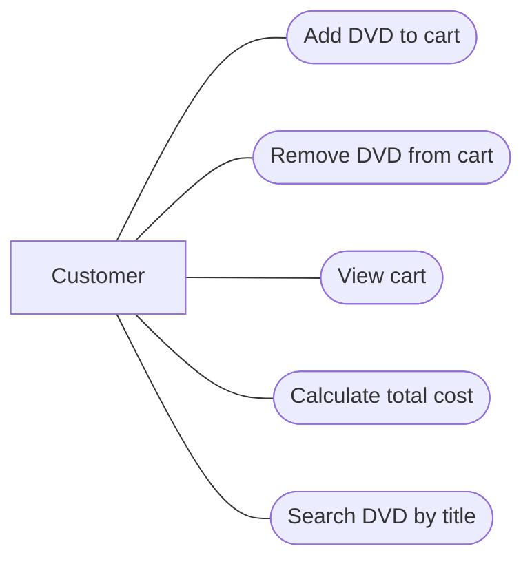

# AIMS-mini Use Case Diagram

## Actor
- Customer: Người sử dụng hệ thống.

## Use Cases
- Add DVD to cart
- Remove DVD from cart
- View cart
- Calculate total cost
- Search DVD by title

## Use Case Diagram

